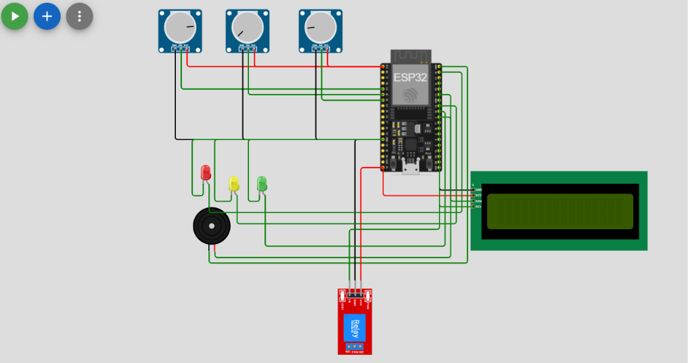

# EV Battery Management System (EV-BMS)

> **Project Name:** EV Battery Management System — Embedded Control, Fault Protection, and IoT Analytics

## Project Overview

The EV Battery Management System is an embedded systems project developed to monitor battery cell voltages, detect faults, implement safety protection mechanisms, and provide real-time system monitoring through an IoT-based Blynk dashboard.

The system integrates embedded control, a modular software architecture, a flicker-free LCD display engine, a structured fault state machine, event-driven telemetry, and advanced analytics to improve battery monitoring, fault diagnosis, and operational safety.

The project uses an ESP32-based controller with Blynk connectivity for remote monitoring and visualization of battery parameters, system health, fault information, and historical trends.

---

## Features

- Modular battery management system architecture
- Real-time monitoring of three battery cell voltages
- Non-blocking protection relay and safety control
- Flicker-free LCD display updates
- Deterministic fault state machine with four operating states:
  - NORMAL
  - DEGRADED
  - FAILSAFE
  - SHUTDOWN
- Fault detection and structured fault-event logging
- Fault identification and recovery handling
- Event-driven telemetry and live Blynk monitoring
- Wi-Fi connection health and signal-strength monitoring
- Battery voltage imbalance analysis
- Risk score and estimated state-of-charge monitoring
- System uptime and fault-count tracking
- Blynk analytics dashboard with historical charts and maintenance recommendations
---

## Hardware Components

| Component | Purpose |
|---|---|
| ESP32 development board | Main embedded controller and Wi-Fi connectivity |
| Battery cell voltage inputs | Monitoring individual cell voltages |
| LCD display | Local system status and fault information |
| Protection relay | Battery safety and load isolation |
| Wi-Fi connection | Communication with the Blynk platform |
| Power supply and connecting wires | Circuit power and hardware interconnection |

---

## Software and Technologies Used

- C/C++ for embedded firmware
- PlatformIO for firmware development and building
- ESP32 GPIO and peripheral control
- Blynk IoT platform
- Blynk Web Dashboard
- Virtual datastreams for telemetry
- Event-driven telemetry and fault reporting
- Git and GitHub for version control and project documentation

---

## System Workflow

1. **Battery monitoring:** The controller reads the three battery cell voltage values.
2. **Safety monitoring:** The firmware checks operating conditions and detects relevant faults.
3. **Fault management:** The fault state machine determines the appropriate operating state and manages fault transitions and recovery.
4. **Protection control:** The protection logic controls the relay according to the system's safety conditions.
5. **Local display:** The LCD displays battery measurements, operating status, and fault information without unnecessary flickering.
6. **Telemetry transmission:** The system publishes battery measurements, fault events, system state, and connectivity information to Blynk.
7. **Analytics and visualization:** The dashboard presents system health indicators, voltage imbalance, estimated battery charge, fault counts, and historical trends.
8. **Recovery and monitoring:** When a fault condition clears, the firmware applies the defined recovery logic and continues monitoring.

---

## Project Tasks and Implementation

### Task 1 — Modular Battery Management System

Established the basic firmware structure for the battery management system, separating functionality into manageable modules for improved maintainability and integration.

### Task 2 — Non-Blocking Protection Relay and Safety System

Implemented relay protection logic designed to manage safety conditions without unnecessarily blocking the main program execution.

### Task 3 — Flicker-Free LCD Display Engine

Developed a display update mechanism to minimize unnecessary LCD redraws and present changing measurements, fault messages, and system status clearly.

### Task 4 — Fault State Machine with Structured Recovery

Implemented a deterministic state machine using NORMAL, DEGRADED, FAILSAFE, and SHUTDOWN states, with structured fault handling, state-transition tracking, and recovery logic.

### Task 5 — Event-Driven Telemetry and Live Blynk Dashboard

Integrated live telemetry for battery cell voltages, fault events, Wi-Fi health, and signal strength. Demonstrated live dashboard monitoring and queue-draining behavior.

### Task 6 — Enterprise Blynk Analytics and Decision Dashboard

Developed the dashboard configuration for system-level analytics, including risk score, system state, uptime, fault count, voltage imbalance, estimated state of charge, maintenance recommendations, last state transition, battery health, and historical charts.

Firmware integration and data validation are required to ensure all configured datastreams receive the correct values.

---

## Blynk Dashboard and Analytics

The dashboard is designed to provide both live monitoring and decision-support information.

| Virtual Pin | Datastream | Purpose |
|---|---|---|
| V0 | Cell Voltage 1 | First cell voltage |
| V1 | Cell Voltage 2 | Second cell voltage |
| V2 | Cell Voltage 3 | Third cell voltage |
| V11 | RiskScore | Calculated risk score |
| V12 | SystemState | Current operating state |
| V13 | Uptime | System uptime |
| V14 | FaultCount | Total fault count |
| V15 | Imbalance | Battery voltage imbalance |
| V16 | EstimatedSoC | Estimated state of charge |
| V17 | Recommendation | Maintenance recommendation |
| V18 | LastTransition | Latest state transition |
| V19 | BatteryHealth | Overall battery health indicator |

The virtual pins listed above describe the dashboard configuration. Correct live values and historical charts depend on the firmware publishing the corresponding data and on Blynk storing the required history.

---

## Repository Structure

The GitHub repository currently contains the following uploaded files:

```text
EV-Battery-Management-System/
│
├── README.md
├── Circuit_Diagram.png
├── demonstration_video.mp4
├── enterprise_blynk_analytics_and_decision_dashboard.zip
├── event_driven_telemetry_and_live_blynk_dashboard.zip
├── fault_state_machine_with_structured_recovery.zip
├── flicker-free_lcd_display_engine.zip
├── modular_battery_management_system.zip
└── non-blocking_protection_relay_and_safety_system.zip
```
---
## Circuit Diagram

The circuit diagram illustrates the hardware connections and overall arrangement of the EV Battery Management System. It serves as a reference for understanding the interfacing between the ESP32 controller, battery voltage measurement inputs, LCD display, protection relay, and other connected peripherals.

## Circuit Diagram


**File:** `Circuit_Diagram.png`

The diagram provides a visual reference for the hardware implementation and supports understanding of the system's embedded control and battery monitoring architecture.

## Demonstration

Watch the demonstration video to see the EV Battery Management System in operation.

[▶ Click here to watch the demonstration video](./demonstration_video.mp4)

**File:** `demonstration_video.mp4`
---

## How to Build and Run

1. Install Visual Studio Code and the PlatformIO extension.
2. Open the project firmware in PlatformIO.
3. Connect the ESP32 development board and required hardware.
4. Configure the battery voltage inputs, LCD, relay, and other peripherals according to the circuit connections.
5. Configure the Blynk template, device credentials, and virtual datastreams.
6. Build and upload the firmware to the ESP32.
7. Open the Blynk Web Dashboard and verify that live measurements and system status are updating.

**Important:** The repository's currently uploaded task archives should be extracted and integrated into the complete firmware project before treating this as a single ready-to-build project. Exact build instructions depend on the final integrated source tree and its configuration files.

---

## Future Improvements

- Verification of offline telemetry buffering and FIFO delivery after reconnection
- Improved battery state-of-charge estimation
- Battery state-of-health estimation using validated measurements
- Long-term historical data analysis
- Advanced fault prediction and risk assessment
- Automated maintenance alerts
- Additional battery temperature and current monitoring
- Improved protection coordination and recovery validation

---

## Author

**Bharti Kunjir**

